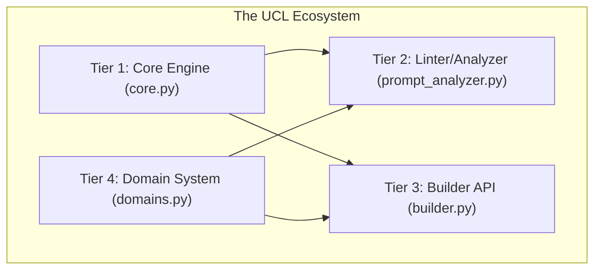

# UCL Linter/Builder Architecture

The Universal Conditional Logic (UCL) Linter and Builder is a 4-tier system designed to provide mathematical rigor to prompt engineering. It bridges the gap between raw natural language and structured, optimized AI instructions.

## 🏗️ 4-Tier Architecture

The system is organized into a modular hierarchy, where each tier handles a specific part of the prompt optimization lifecycle.

### 1. Core Engine (`core.py`)
The foundation of the entire framework. It contains:
- **Mathematical Constants**: Empirically derived values for $S^*$, $O_s$ weights, and bonus/penalty rates.
- **UCL Element Hierarchy**: Base classes (`UCLElement`) and primitives (Directive, Concept, Condition, Section).
- **The Scoring Engine**: The implementation of the quality function $Q(S)$ and Structural Overhead ($O_s$).

### 2. Linter/Analyzer (`prompt_analyzer.py`)
The diagnostic tier. It analyzes *existing* text for optimization potential:
- **Pattern Detection**: Uses specialized REGEX groups to identify UCL syntax in raw text.
- **Metric Estimation**: Derives $S$ (specification level) and $O_s$ (structural overhead) from textual density and complexity.
- **Anti-Pattern Engine**: Flagging violations such as role-questioning, excessive SWITCH statements, or missing CRITICAL headers.

### 3. Builder API (`builder.py`)
The construction tier. It provides a fluent, developer-friendly interface for building "Correct-by-Construction" prompts:
- **Fluent Interface**: Methods like `.set_identity()`, `.add_critical()`, and `.add_domain()`.
- **Automatic Optimization**: Automatically places the [[CRITICAL:]] directive at the top and wraps domain logic in keyword-based conditions.
- **Real-time Scoring**: Provides immediate feedback on $O_s$ impact as elements are added.

### 4. Domain System (`domains.py`)
The knowledge tier. It encapsulates specialized expertise into modular components:
- **Domain Primitives**: Sets of keywords and directives specific to fields like Mathematics, Physics, or Coding.
- **Dynamic Targeting**: Allows the prompt to "activate" specific logic only when user keywords match.

---

## 🔄 Interaction Flow

1. **Input**: A developer uses the **Builder API** or passes raw text to the **Analyzer**.
2. **Analysis**: The system parses elements and calculates their **Structural Overhead ($O_s$)**.
3. **Calculation**: The **Core Engine** computes the **Specification Level ($S$)** and predicts **Quality ($Q$)**.
4. **Validation**: The **Linter** runs anti-pattern checks and issues warnings.
5. **Output**: A fully optimized UCL string and a detailed mathematical score report.
